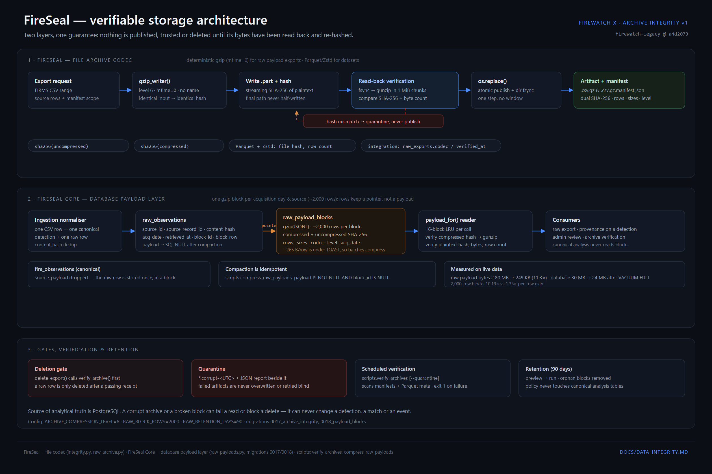

# FireSeal architecture

FireSeal is the storage-integrity layer of the FIREWATCH X engine. It answers one question for
every byte the platform keeps: **can we prove that this artifact is exactly what was written?**

It is split into two deliberately separate layers:

| Layer | Scope | Code |
|---|---|---|
| **FireSeal** | Files: raw CSV payload exports (gzip) and detection datasets (Parquet/Zstandard) | `backend/app/services/integrity.py`, `backend/app/services/raw_archive.py` |
| **FireSeal Core** | The live database: batch-compressed raw payloads in PostgreSQL | `backend/app/services/raw_payloads.py`, migrations `0017`, `0018` |

The file codec protects *provenance archives*; the database layer keeps the *live store* small.
Neither layer ever rewrites canonical analysis (`fire_observations`, matches, events).



*Vector source: [`diagrams/fireseal-architecture.svg`](diagrams/fireseal-architecture.svg).*

---

## 1. Guarantees

1. **No partially written artifact is ever visible.** Data goes to a sibling `.part` file and is
   published with one `os.replace()`; the final path never exists half-written.
2. **Two SHA-256 values per artifact** — the uncompressed (logical) content and the compressed
   bytes — so either side can be audited independently.
3. **Read-back verification before publication.** The artifact is decompressed and re-hashed at
   write time, so truncation, bit rot, a broken compressor or a short write fail *immediately*.
4. **Deletion requires a passing receipt.** Raw payload rows are removed only after the export
   archive re-verifies. A corrupt archive blocks deletion.
5. **Failures are quarantined, never overwritten or blindly retried** — the file is moved aside
   with a JSON report describing what happened.
6. **Deterministic compression.** Gzip is written with `mtime=0` and no filename, so the same bytes
   at the same level always produce the same compressed hash.

---

## 2. Layer 1 — the FireSeal file codec

### 2.1 Write path (raw payload export)

`raw_archive.create_export()` streams a date range of FIRMS CSV rows through the codec:

```
write_archive(chunks, final_path, level):
    temp = final_path + ".part"
    uncompressed_hash = SHA256();  uncompressed_bytes = 0
    open temp for binary write
    gz = gzip(stream=temp, level=level, mtime=0)      # deterministic
    for chunk in chunks:
        uncompressed_hash.update(chunk);  uncompressed_bytes += len(chunk)
        gz.write(chunk)
    gz.close(); fsync(temp)

    # read-back verification, bounded at 1 MiB
    verify_hash = SHA256();  verify_bytes = 0
    for block in decompress_gzip(temp, chunk=1 MiB):
        verify_hash.update(block);  verify_bytes += len(block)
    if verify_hash != uncompressed_hash or verify_bytes != uncompressed_bytes:
        quarantine(temp, reason="gzip_verification_failed")
        raise IntegrityError

    compressed_sha = SHA256(temp)
    atomic_rename(temp, final_path)                    # os.replace + dir fsync
    write_json(final_path + ".manifest.json", manifest)
```

Key properties:

- **Hashing happens while writing**, so the plaintext identity is known before any compression
  decision is trusted.
- **Verification is bounded** (`CHUNK = 1 MiB`), so multi-gigabyte exports do not exhaust memory.
- **`os.replace` is the publication step**; on POSIX the containing directory is fsynced as well.
- The manifest is itself written atomically.

### 2.2 Manifest

Every artifact carries a sidecar with everything an auditor needs, without a database:

```json
{
  "path": "raw_2026-10-28_2026-11-01_a1b2c3d4.csv.gz",
  "codec": "gzip",
  "compression_level": 6,
  "compressed_bytes": 1830244,
  "uncompressed_bytes": 9812345,
  "compressed_sha256": "…",
  "uncompressed_sha256": "…",
  "rows": 9990,
  "created_at": "2026-11-07T12:39:25+00:00",
  "integrity_version": "archive-integrity-v1",
  "start_date": "2026-10-28",
  "end_date": "2026-11-01",
  "kind": "raw_export"
}
```

`raw_exports` mirrors the receipt in the database (`codec`, `compressed_sha256`,
`uncompressed_size`, `verified_at` — migration `0017_archive_integrity`).

### 2.3 Parquet datasets

The detection-export path uses the same shape with Polars/Zstandard:

`.part.parquet` → read back with Polars and compare the **logical row count** → atomic rename →
JSON sidecar with the file SHA-256 and row count (`integrity.verify_parquet`).

### 2.4 Quarantine

`integrity.quarantine(path, reason)` moves the file to
`<name>.corrupt-<UTC timestamp>` and writes `<file>.corrupt-<stamp>.json`:

```json
{ "original": "…", "quarantined": "…", "reason": "gzip_verification_failed", "at": "2026-11-07T12:39:25+00:00" }
```

Nothing is deleted and nothing is retried against the same path — recovery is a deliberate decision.

---

## 3. Layer 2 — FireSeal Core (database payloads)

### 3.1 Problem

`raw_observations.payload` stored the original FIRMS JSONB row per detection. Rows average
~265 bytes, well under PostgreSQL's TOAST threshold (~2 KB), so the row store never compressed
them; and `fire_observations.source_payload` duplicated the same payload a second time.

### 3.2 Data model (migration `0018_payload_blocks`)

| Object | Purpose |
|---|---|
| `raw_payload_blocks` | one gzip block of JSONL payloads per acquisition day and source (~2,000 rows), with `rows`, `uncompressed_bytes`, `compressed_bytes`, `uncompressed_sha256`, `compressed_sha256`, `codec`, `compression_level` |
| `raw_observations` | small indexed columns only: `source_id`, `source_record_id`, `content_hash`, `acq_date`, `retrieved_at`, `block_id`, `block_row` |
| `fire_observations` | canonical analysis; **`source_payload` was dropped** — the raw row is stored once |

### 3.3 Block algorithm

```
for each acquisition day:
    for chunk of 2000 raw rows:
        content  = JSON lines (sorted keys, compact separators)
        block    = gzip(content, level=ARCHIVE_COMPRESSION_LEVEL, mtime=0)
        store block {compressed_sha256, uncompressed_sha256, rows, sizes, data}
        point each raw row at (block_id, block_row)
        set legacy inline payload to SQL NULL (not JSON null)
```

Batch blocks are the correct compression unit: **10.19×** for 2,000-row blocks versus **1.33×**
for per-row gzip, measured on real FIRMS payloads.

### 3.4 Read path

```python
from app.services import raw_payloads
payload = raw_payloads.payload_for(session, raw_row)
```

1. A `PayloadBlockCache` (16-entry LRU, per call) avoids decompressing the same block twice during
   an export.
2. `decode_block()` verifies the **compressed** SHA-256, gunzips, then verifies the **uncompressed**
   SHA-256, the byte count and the row count.
3. `payload_for()` returns the row at `block_row`; legacy rows with an inline `payload` still work
   unchanged.

Any mismatch raises `IntegrityError` — a tampered or truncated block fails the read instead of
silently returning wrong provenance.

### 3.5 Existing databases

```
alembic upgrade head          # 0017_archive_integrity → 0018_payload_blocks
python -m scripts.compress_raw_payloads [--dry-run]
```

The backfill is idempotent: it only touches `payload IS NOT NULL AND block_id IS NULL`, batches
commits, and is safe to interrupt. `VACUUM FULL` afterwards returns freed heap pages to the OS.

---

## 4. Gates and operations

### 4.1 Export-before-delete

`raw_archive.delete_export()` refuses to delete a range until the export archive **re-verifies**:

```
verify_archive(artifact)  →  only then DELETE raw_observations …  →  remove orphan blocks
```

Retention (`RAW_RETENTION_DAYS = 90`) follows the same rule: preview first, then run, and only
provenance rows are touched.

### 4.2 Scheduled verification

```
python -m scripts.verify_archives              # report only
python -m scripts.verify_archives --quarantine # move failures aside with a report
```

The job walks `data/raw_exports/*.manifest.json` and every Parquet `*.meta.json`, checks the
compressed hash, size and decompressed content hash / row count, prints per-artifact stats, and
**exits 1** if anything failed — suitable for CI or a cron/monitoring check.

### 4.3 Failure handling

| Failure | Behaviour |
|---|---|
| Hash mismatch at write | `.part` quarantined, nothing published, exception raised |
| Corrupt archive found later | quarantined with a JSON report; delete endpoint keeps refusing |
| Missing manifest | artifact not trusted; regenerate it (a `.part` file is never a dataset) |
| Corrupt Parquet partition | re-export that month; analysis tables untouched |
| Corrupt payload block | `IntegrityError` on read; canonical analysis unaffected |

---

## 5. Configuration

| Setting | Default | Effect |
|---|---|---|
| `ARCHIVE_COMPRESSION_LEVEL` | `6` | gzip level (1 fastest … 9 smallest); recorded in the manifest |
| `RAW_BLOCK_ROWS` | `2000` | rows per compressed payload block |
| `RAW_RETENTION_DAYS` | `90` | raw payload retention window |

---

## 6. Measured result (live data, 2026-11-08)

| Object | Before | After |
|---|---:|---:|
| Database | 30 MB | **24 MB** |
| `fire_observations` | 11 MB | 7.3 MB |
| `raw_observations` | 7.2 MB | 3.9 MB |
| Raw payload bytes | 2.80 MB | **249 KB in 10 blocks** |
| Compression | none | **11.3×** |

---

## 7. Where this lives

FireSeal is now part of this tree (`main`): the ingestion tunnel writes payload blocks,
`raw_archive` exports through the verified codec, and the delete gate re-verifies the archive.
The FIREWATCH-era implementation is also preserved on branch `firewatch-legacy` (`a4d2073`).

> **Integration status (2026-11-14).** The tunnel and the storage layer are one path:
> `ingest_range → _store_response → _build_payload_blocks → raw_payload_blocks`, with
> `raw_observations (block_id, block_row)` pointers, and `create_export → verify → delete` on the
> way out. `python -m scripts.verify_archives` reports 27 raw archives and 1 Parquet dataset OK.

The two storage paths now coexist:

- **FireSeal** keeps provenance *inside* PostgreSQL at 11× and proves every file it writes.
- **HERMES** also exports to Parquet/R2 with DuckDB verification and prunes the JSONB copy only
  after checksummed export coverage.

FireSeal's read-back/dual-hash receipt is the guarantee in front of that pruning, which is what
`datacompressionprompt.md` asks for.

## 8. Reference

| Concern | File |
|---|---|
| Codec, manifests, quarantine, Parquet verify | `backend/app/services/integrity.py` |
| Export, delete gate, retention | `backend/app/services/raw_archive.py` |
| Block reader and cache | `backend/app/services/raw_payloads.py` |
| Legacy backfill | `backend/scripts/compress_raw_payloads.py` |
| Verification job | `backend/scripts/verify_archives.py` |
| Schema | `backend/migrations/versions/0017_archive_integrity.py`, `0018_payload_blocks.py` |
